# Entity-Relationship Design Documentation
### ALCSM Research Database, Schema v1.0.1 — Thesis Chapter 3 (Database Design)

> **Version note.** Updated for schema **v1.0.1** (implementation freeze). Corrections F-01–F-05 changed one view definition and added CHECK constraints; **entities, keys, cardinality and normalisation are unchanged**. ER structure re-verified against the deployed catalogue: 22 entities, 33 relationships, zero discrepancies.

**Scope:** documentation only. The schema was not modified. All structural facts below were extracted from the deployed PostgreSQL 16 catalogue (`pg_constraint`, `information_schema`) rather than transcribed from the DDL, so the documentation reflects what the database actually enforces.

**Correction to the Task 4 summary.** That document reported "eighteen tables." The catalogue shows **22 base tables and 5 views**. The earlier figure was an undercount, corrected here; the schema itself is unchanged.

---

## 1. Entity Inventory

Twenty-two base tables in four functional layers.

### Layer 1 — Reference entities (controlled vocabularies)

| Entity | Purpose | Cardinality |
|---|---|---|
| `dimension_ref` | The six frozen ALCSM dimensions, their codes, verifiability tier, and verification permission | Fixed at 6 rows |
| `missing_status_ref` | The four-state missing-data encoding | Fixed at 4 rows |
| `precedent_ref` | Binding coding precedents P-01…P-15 | Fixed at 15 rows |
| `rater_ref` | Annotators and their roles | ~3 rows |
| `taxonomy_version` | Versioned instances of the eight frozen taxonomies | One per taxonomy per version |
| `taxonomy_term` | Term lists belonging to a taxonomy version | Many per version |

### Layer 2 — Provenance and corpora

| Entity | Purpose | Expected volume |
|---|---|---|
| `sampling_batch` | One documented, reproducible search | ~5–15 |
| `profile` | Pseudonymous LinkedIn profile record | ~500 |
| `profile_raw_section` | Verbatim text of one profile section | ~3,500 (7 sections × 500) |
| `job_posting` | Job posting record with raw text retained | ~200 |

### Layer 3 — Annotation, adjudication and criterion

| Entity | Purpose | Expected volume |
|---|---|---|
| `alcsm_dimension_score` | One dimension score by one rater for one profile | ~3,000–3,450 |
| `job_requirement_score` | One required level by one rater for one posting | ~1,200 |
| `profile_derived` | Computed profile-level flags | ~500 |
| `rq4_impact_indicator` | External criterion variables | ~500 |
| `adjudication_record` | Documented resolution of a rater disagreement | variable |

### Layer 4 — Automation, validation and audit

| Entity | Purpose |
|---|---|
| `nlp_model_run` | One pipeline execution with reproducibility metadata |
| `nlp_prediction` | One model-predicted dimension score |
| `reliability_result` | Stored per-dimension reliability statistics |
| `annotation_revision_log` | Rulebook revision audit trail |
| `survey_instrument` | Versioned survey instrument |
| `survey_respondent` | Consented expert respondent |
| `survey_response_item` | One item response |

---

## 2. Primary Keys

Two deliberate conventions coexist.

**Natural, human-readable keys** are used for entities a researcher refers to by name, with format enforced by `CHECK` constraints:

| Entity | PK | Format constraint |
|---|---|---|
| `profile` | `profile_id` | `^PRF-[0-9]{5}$` |
| `job_posting` | `posting_id` | `^JOB-[0-9]{5}$` |
| `survey_respondent` | `respondent_id` | `^RSP-[0-9]{4}$` |
| `sampling_batch` | `sampling_batch_id` | `^BATCH-[0-9]{3}$` |
| `precedent_ref` | `precedent_id` | `^P-[0-9]{2}$` |
| `nlp_model_run` | `pipeline_run_id` | `^RUN-[0-9]{4}$` |

**Surrogate `BIGSERIAL` keys** are used for high-volume child tables where no meaningful natural key exists: `alcsm_dimension_score`, `job_requirement_score`, `profile_raw_section`, `nlp_prediction`, `adjudication_record`, `reliability_result`, `annotation_revision_log`, `taxonomy_term`, `survey_response_item`.

**Inherited keys** are used where a one-to-one relationship exists: `profile_derived.profile_id` and `rq4_impact_indicator.profile_id` are simultaneously primary and foreign keys, which enforces at most one row per profile structurally.

**Semantic keys** are used where the value is itself the identifier: `dimension_ref.dimension_number`, `missing_status_ref.missing_status`, `rater_ref.rater_id`, `survey_instrument.survey_version`.

### 2.1 Composite uniqueness (the analytically important constraints)

Surrogate PKs do not define the *analytical grain*. Six `UNIQUE` constraints do:

| Entity | Unique tuple | What it prevents |
|---|---|---|
| `alcsm_dimension_score` | (`profile_id`, `dimension_number`, `rater_id`, `rulebook_version`) | Duplicate coding of the same dimension by the same rater under the same rulebook |
| `job_requirement_score` | (`posting_id`, `dimension_number`, `rater_id`, `rulebook_version`) | As above, posting side |
| `profile_raw_section` | (`profile_id`, `section_name`) | Duplicate capture of a section |
| `nlp_prediction` | (`profile_id`, `dimension_number`, `pipeline_run_id`) | Duplicate predictions within a run |
| `taxonomy_term` | (`taxonomy_version_id`, `term`) | Duplicate terms in a version |
| `survey_response_item` | (`respondent_id`, `item_code`) | Duplicate item responses |

Including `rulebook_version` in the first two is deliberate: re-coding under a *revised* rulebook is legitimate and produces a new row, whereas re-coding under the *same* rulebook is an error. The constraint distinguishes these.

---

## 3. Foreign Keys

Thirty-three foreign keys, **all declared `ON DELETE RESTRICT`**. No cascade exists anywhere in the schema.

### 3.1 Complete FK inventory

| Child entity | Column | → Parent | Meaning |
|---|---|---|---|
| `profile` | `sampling_batch_id` | `sampling_batch` | Provenance |
| `job_posting` | `sampling_batch_id` | `sampling_batch` | Provenance |
| `profile_raw_section` | `profile_id` | `profile` | Section belongs to profile |
| `profile_derived` | `profile_id` | `profile` | Derived summary |
| `rq4_impact_indicator` | `profile_id` | `profile` | Criterion values |
| `rq4_impact_indicator` | `extracted_by` | `rater_ref` | Extraction attribution |
| `alcsm_dimension_score` | `profile_id` | `profile` | Score subject |
| `alcsm_dimension_score` | `dimension_number` | `dimension_ref` | Which dimension |
| `alcsm_dimension_score` | `rater_id` | `rater_ref` | Who coded |
| `alcsm_dimension_score` | `missing_status` | `missing_status_ref` | Missing-data state |
| `alcsm_dimension_score` | `precedent_applied` | `precedent_ref` | Governing precedent |
| `alcsm_dimension_score` | `taxonomy_version_id` | `taxonomy_version` | Taxonomy in force |
| `job_requirement_score` | `posting_id` | `job_posting` | Score subject |
| `job_requirement_score` | `dimension_number`, `rater_id`, `missing_status`, `precedent_applied`, `taxonomy_version_id` | (as above) | Parallel structure |
| `adjudication_record` | `profile_id` | `profile` | Profile-side adjudication |
| `adjudication_record` | `posting_id` | `job_posting` | Posting-side adjudication |
| `adjudication_record` | `dimension_number` | `dimension_ref` | Which dimension |
| `adjudication_record` | `adjudicator_id` | `rater_ref` | Who adjudicated |
| `nlp_model_run` | `dimension_number` | `dimension_ref` | Target dimension |
| `nlp_prediction` | `profile_id`, `dimension_number`, `pipeline_run_id`, `predicted_missing_status` | (as above) | Prediction context |
| `taxonomy_term` | `taxonomy_version_id` | `taxonomy_version` | Term membership |
| `reliability_result` | `dimension_number` | `dimension_ref` | Per-dimension statistic |
| `annotation_revision_log` | `dimension_number` | `dimension_ref` | Affected dimension |
| `survey_respondent` | `survey_version` | `survey_instrument` | Instrument version |
| `survey_response_item` | `respondent_id` | `survey_respondent` | Response ownership |
| `survey_response_item` | `dimension_number` | `dimension_ref` | Optional dimension link |

### 3.2 Documented referential deviation

`taxonomy_version.anchored_to_batch` stores a batch identifier as **plain `TEXT` without a foreign key** to `sampling_batch`. Referential integrity is therefore not enforced on that column: a taxonomy version could reference a batch that does not exist. This is a real, if minor, integrity gap and should be acknowledged rather than presented as fully normalised. It is detectable by a validation query and does not affect scoring.

---

## 4. Cardinality and Relationship Descriptions

Standard notation: `1` mandatory one, `0..1` optional one, `1..*` one-or-more, `0..*` zero-or-more.

| Relationship | Cardinality | Description |
|---|---|---|
| `sampling_batch` → `profile` | 1 : 0..* | A documented search yields many profiles; every profile traces to exactly one batch, preserving the audit trail from search string to record. |
| `sampling_batch` → `job_posting` | 1 : 0..* | As above, posting side. |
| `profile` → `profile_raw_section` | 1 : 0..* | A profile decomposes into up to seven named sections. Fewer than seven means some sections were not captured — itself recorded data. |
| `profile` → `alcsm_dimension_score` | 1 : 0..* | Up to 6 dimensions × *n* raters (+ adjudication rows). Single-coded: 6 rows. Double-coded with one adjudication: 13. |
| `profile` → `profile_derived` | 1 : 0..1 | At most one derived summary, enforced by shared PK. |
| `profile` → `rq4_impact_indicator` | 1 : 0..1 | At most one criterion row; optional because criterion extraction may lag annotation. |
| `profile` → `nlp_prediction` | 1 : 0..* | One prediction per dimension per pipeline run. |
| `job_posting` → `job_requirement_score` | 1 : 0..* | Structurally parallel to the profile side, deliberately kept in a separate relation. |
| `dimension_ref` → (7 relations) | 1 : 0..* | The six dimensions classify scores, requirements, predictions, adjudications, reliability results, model runs and survey items — a single authoritative definition reused everywhere. |
| `missing_status_ref` → (3 relations) | 1 : 0..* | One vocabulary governs profile scores, requirement scores and predictions, so missingness semantics cannot diverge between corpora. |
| `rater_ref` → (4 relations) | 1 : 0..* | Attribution of coding, adjudication and criterion extraction. |
| `precedent_ref` → (2 relations) | 1 : 0..* | Links a score to the precedent that governed it, making the rulebook queryable rather than merely documentary. |
| `taxonomy_version` → `taxonomy_term` | 1 : 0..* | A version contains many terms; terms never exist outside a version. |
| `taxonomy_version` → scores | 1 : 0..* | Every score records the taxonomy in force at coding time. |
| `nlp_model_run` → `nlp_prediction` | 1 : 0..* | A run produces many predictions; every prediction traces to a seeded, versioned run. |
| `profile`/`job_posting` → `adjudication_record` | 1 : 0..* | An adjudication references **exactly one** corpus, enforced by `ck_adjudication_one_corpus`. |
| `survey_instrument` → `survey_respondent` | 1 : 0..* | Instrument versioning. |
| `survey_respondent` → `survey_response_item` | 1 : 0..* | Item responses. |

**Absent by design:** there is no relationship between `survey_respondent` and `profile`. Expert respondents and audited profiles are disjoint populations; a link would imply the survey evaluates specific individuals, which it does not.

---

## 5. Normalization Analysis

### 5.1 First Normal Form (1NF)
Satisfied throughout. Every attribute is atomic; there are no repeating groups, arrays or delimited multi-value fields. Two design choices are what secure 1NF:

- **Profile sections** are rows in `profile_raw_section`, not seven columns on `profile`. Seven fixed section columns would constitute a repeating group.
- **Dimension scores** are rows in `alcsm_dimension_score`, not six columns (`d1_score … d6_score`) on `profile`. The wide alternative is the more common student design and violates 1NF by encoding a repeating attribute group positionally. It would also make per-dimension reliability analysis require six separate queries instead of one grouped query.

### 5.2 Second Normal Form (2NF)
Satisfied. The tables with composite analytical grain — `alcsm_dimension_score` and `job_requirement_score` — carry attributes dependent on the *whole* grain (profile × dimension × rater), not part of it. `score`, `evidence_text`, `missing_status` and the flags all require all three components to be determined; none depends on, say, `dimension_number` alone. Attributes that *do* depend on `dimension_number` alone (label, verifiability tier, verification permission) live in `dimension_ref`, which is precisely the 2NF decomposition.

### 5.3 Third Normal Form (3NF) — with one documented deviation

Most of the schema is in 3NF: non-key attributes depend on the key and nothing else, and lookup attributes are factored into reference tables rather than repeated inline.

**However, a genuine 3NF violation exists and should be disclosed rather than glossed over.** `profile.search_query` and `job_posting.search_query` duplicate `sampling_batch.search_query`. Since `sampling_batch_id` is a non-key attribute of `profile` that functionally determines `search_query`, this is a transitive dependency:

```
profile_id → sampling_batch_id → search_query
```

Strict 3NF would remove `search_query` from `profile` and obtain it by join.

**Why the denormalisation is retained — and the honest cost.** Provenance is evidentiary: it records what was true at the moment of collection. If `sampling_batch.search_query` were ever edited or corrected, a joined query would retroactively rewrite the recorded provenance of every profile in that batch, silently altering the audit trail the frozen framework requires. Storing the query on the record freezes it against later mutation.

The cost is a real update anomaly: the two copies can diverge, and nothing in the schema prevents it. A validation query should confirm they agree, and any deliberate divergence should be documented. This is a defensible trade-off, not a flaw-free design, and presenting it as such is more defensible at examination than claiming full 3NF compliance.

`profile.search_rank_position` is *not* a violation — rank is specific to the individual record within the result set, not determined by the batch.

### 5.4 Beyond 3NF
The schema is close to BCNF; no non-trivial functional dependency has a non-superkey determinant other than the documented case above. Higher normal forms (4NF/5NF) are not engaged: no multi-valued dependencies or join dependencies arise, because the many-to-many structures (profile × dimension × rater) are resolved through relations whose non-key attributes genuinely depend on the full composite.

---

## 6. Design Rationale

### 6.1 Governing principle
Frozen methodological rules are enforced by the database wherever expressible as a constraint, rather than by annotator discipline or analyst memory. A rule written only in a rulebook degrades across 500 profiles and several months; a `CHECK` constraint does not. Empirical validation confirmed this: eighteen deliberate rule violations were all rejected by the database, exercising fifteen distinct named constraints.

### 6.2 Reference-table strategy
Controlled vocabularies are stored as `TEXT` with foreign keys to small reference tables rather than as integer codes. Exported data is then self-describing — a CSV shows `absent_stated`, not `2` — which matters for a thesis appendix and for supervisor review. The cost in storage is negligible at this scale.

### 6.3 No cascading deletes
Every one of the 33 foreign keys uses `ON DELETE RESTRICT`. Research data must not be silently destructible: deleting a profile that carries scores would erase the evidentiary basis of an analysis. Deletion requires explicit, deliberate removal of dependents first.

### 6.4 Absence of a composite score column
No `alcsm_total`, `alcsm_composite` or `alcsm_band` column exists anywhere. Aggregation function, dimension weights and classification thresholds remain deliberately open pending empirical validation. Materialising a composite would silently commit the analysis to one aggregation method and propagate it through every downstream query. Composites are therefore computed at analysis time and versioned by method.

---

## 7. Why Certain Entities Were Separated

**`profile` from `profile_raw_section`.** Discussed in §9 below.

**`alcsm_dimension_score` from `job_requirement_score`.** The two are structurally near-identical, which invites a single table with a corpus discriminator. They are deliberately separated because the frozen framework holds that *required* and *held* levels are **not commensurable**: "a Master's is required" is a threshold statement, while "this person holds a score-4 education" is an attainment statement. A shared table makes accidental pooling a single `WHERE` clause away; separate tables make it a deliberate, visible act. The posting side also carries `requirement_modality` (required / preferred / unspecified), which has no meaning on the profile side.

**`profile` from `profile_derived`.** Derived values (`completeness_index`, contradiction flag, `double_coded`) are computed artefacts that change when coding changes or a rulebook is revised. Keeping them out of the base entity preserves a clean separation between *observed* and *computed* data, and allows recomputation without touching collected records.

**`rq4_impact_indicator` from everything else.** Discussed in §10.

**`adjudication_record` from `alcsm_dimension_score`.** Discussed in §11.

**`nlp_model_run` from `nlp_prediction`.** Run-level metadata (model version, random seed, commit hash, information base) depends on the run, not the individual prediction. Repeating it per prediction would violate 2NF and, more practically, make it impossible to state cleanly which information base a set of predictions used — the guarantee that underpins the RQ5 human-versus-machine comparison.

---

## 8. Why Long-Format Text Storage Was Selected

The intuitive design gives `profile` seven text columns (`raw_headline`, `raw_about`, …). The schema instead uses `profile_raw_section`, one row per section, with an explicit `section_available` boolean.

**The decisive reason is measurement validity, not database aesthetics.** In a wide design, a `NULL` in `raw_certifications` is ambiguous between two states the frozen framework requires to be distinguished:

1. the section exists on the profile but is empty; and
2. the section was not retrievable at collection.

State (2) is a *collection artefact*; state (1) is *evidence about the person*. Conflating them would propagate directly into the `unavailable` missing-status determination, and from there into `completeness_index` and every missingness analysis. Since the frozen rules require `unavailable` and `absent_stated` never to be pooled, a design that structurally cannot distinguish their upstream causes would undermine the rule at the point of data capture.

Secondary benefits: section-level capture timestamps; the ability to add a section type without a schema migration; per-section provenance for NLP extraction; and 1NF compliance (§5.1).

**The cost is real and should be stated:** reconstructing a full profile requires a join or pivot, and simple exploratory queries are more verbose. This is an accepted trade of query convenience for measurement integrity.

---

## 9. Why Criterion Variables Are Isolated

`rq4_impact_indicator` is a separate relation, keyed on `profile_id`, holding the RQ4 observable professional impact indicators. Three reasons, in increasing order of importance:

1. **Conceptual.** ALCSM measures *credential signals*; the criterion variables measure *professional visibility and reach*. They are different constructs and the analysis exists to test the relationship between them.

2. **Statistical.** Under the formative measurement specification, internal consistency is unavailable as validity evidence, so criterion validity carries much of the load. If a variable served both as an index component and as the index's external criterion, any observed association would be partly circular. Physical separation makes the boundary auditable: one can verify by inspection that no criterion column feeds a dimension score. This is why externally verifiable technical outputs (citations, patents, repository metrics) inform D4 and are *excluded* from `rq4_recognition_count`, which counts only recognition conferred by third parties.

3. **Procedural.** The annotation interface must not display criterion values to raters while they code dimensions. Knowing a profile's follower count while scoring Professional Engagement is a direct contamination route between predictor and criterion. A separate relation makes the access boundary trivial to implement and to demonstrate.

**One residual weakness, disclosed in the schema itself.** `rq4_seniority_progression_rate` is derived from employment history, the same source text as D5. The constructs differ (trajectory over time versus current static level) and the D5 score is barred as an input, but this is the weakest of the four independence claims. A column comment carries this caveat so it travels with the data rather than living only in prose.

---

## 10. Why Adjudicated Scores Are Stored Separately

Adjudication is **additive, never destructive**. When two raters disagree and a third party resolves it, the adjudicated value is inserted as a **new row** in `alcsm_dimension_score` with `is_adjudication = TRUE` and `rater_id = 'ADJUDICATOR'`. The original rater rows are never updated or deleted.

The alternative — overwriting the disputed score with the adjudicated value — would be simpler and is what most implementations do. It is also **fatal to the reliability analysis**, because inter-rater reliability must be computed on the raters' *independent, pre-adjudication* judgements. Once originals are overwritten, the disagreement that reliability is meant to quantify no longer exists in the data, and any α computed afterwards measures agreement *after* the disagreements were removed — a figure that would be spuriously high and, worse, unrecoverable.

A separate `adjudication_record` relation stores the resolution audit: both raters' scores, the disagreement magnitude (a `GENERATED ALWAYS AS (abs(...)) STORED` column, so it cannot drift from its inputs), the resolution route, the final score, the adjudicator and the documented reason. This makes adjudication itself analysable — how often disagreements occurred, on which dimensions, at what magnitude — which is reportable evidence about the coding process rather than merely an administrative record.

---

## 11. How Reliability Analysis Is Protected by the Schema

Five independent mechanisms, in order of importance:

**(a) Non-destructive adjudication.** As above: the raw disagreements survive in the data permanently.

**(b) A filtered view as the analytical entry point.** `v_reliability_input` selects only rows where `is_adjudication = FALSE` **and** the rater's role is `primary` or `secondary`. Analysis code queries the view rather than the base table, so adjudicated and adjudicator rows cannot enter a reliability computation through oversight. Empirically verified: for a double-coded, adjudicated dimension holding three score rows, the view returns exactly two.

**(c) Grain enforcement.** The `UNIQUE` constraint on (`profile_id`, `dimension_number`, `rater_id`, `rulebook_version`) guarantees at most one independent judgement per rater per dimension, preventing duplicate rows from inflating apparent agreement, while still permitting legitimate re-coding under a revised rulebook.

**(d) Per-dimension storage with diagnostic context.** `reliability_result` stores α **per dimension** — never pooled — together with bootstrap confidence bounds, raw percentage agreement, `n_units` and `score_variance`. Variance is stored deliberately: on dimensions where scores cluster (likely D5 and D6, given their low verifiability), α can be deflated by low variance despite high raw agreement. Without variance recorded alongside, a low coefficient is indistinguishable from poor coding.

**(e) Row-level role alignment [added in v1.0.1].** `ck_adjudication_role_alignment` requires `is_adjudication = TRUE` if and only if `rater_id = 'ADJUDICATOR'`. In v1.0.0 the two could disagree, so a primary rater's row flagged `TRUE` would have been silently excluded from `v_reliability_input` with no error raised — the most dangerous class of defect, because it corrupts α invisibly. Mechanism (b) caught the converse case but not this one. The gap is now closed at row level on both scoring tables.

---

## 12. Mermaid ER Diagram

The complete diagram is provided as `alcsm_er_diagram.mermaid` (22 entities, 33 relationships, structurally validated: no undefined or orphaned entities). A simplified core view suitable for inline inclusion in Chapter 3:

```mermaid
erDiagram
    SAMPLING_BATCH ||--o{ PROFILE : "yields"
    SAMPLING_BATCH ||--o{ JOB_POSTING : "yields"
    PROFILE ||--o{ PROFILE_RAW_SECTION : "decomposes into"
    PROFILE ||--o{ ALCSM_DIMENSION_SCORE : "is coded by"
    PROFILE ||--|| PROFILE_DERIVED : "summarised by"
    PROFILE ||--o| RQ4_IMPACT_INDICATOR : "has criterion values"
    PROFILE ||--o{ NLP_PREDICTION : "is predicted for"
    PROFILE ||--o{ ADJUDICATION_RECORD : "may require"
    JOB_POSTING ||--o{ JOB_REQUIREMENT_SCORE : "is coded by"
    DIMENSION_REF ||--o{ ALCSM_DIMENSION_SCORE : "classifies"
    DIMENSION_REF ||--o{ JOB_REQUIREMENT_SCORE : "classifies"
    DIMENSION_REF ||--o{ RELIABILITY_RESULT : "classifies"
    MISSING_STATUS_REF ||--o{ ALCSM_DIMENSION_SCORE : "encodes"
    MISSING_STATUS_REF ||--o{ JOB_REQUIREMENT_SCORE : "encodes"
    RATER_REF ||--o{ ALCSM_DIMENSION_SCORE : "assigns"
    RATER_REF ||--o{ ADJUDICATION_RECORD : "adjudicates"
    PRECEDENT_REF ||--o{ ALCSM_DIMENSION_SCORE : "governs"
    TAXONOMY_VERSION ||--o{ TAXONOMY_TERM : "contains"
    TAXONOMY_VERSION ||--o{ ALCSM_DIMENSION_SCORE : "versions"
    NLP_MODEL_RUN ||--o{ NLP_PREDICTION : "produces"
    SURVEY_INSTRUMENT ||--o{ SURVEY_RESPONDENT : "administered to"
    SURVEY_RESPONDENT ||--o{ SURVEY_RESPONSE_ITEM : "answers"
```



---

## 13. Draft Text for Thesis Chapter 3 (Database Design)

> ### 3.x Database Design
>
> The research database was implemented in PostgreSQL 16 and comprises 22 base relations and five analytical views, with sixty-six check constraints and thirty-one foreign keys, organised into four layers: reference vocabularies, provenance and corpora, annotation and criterion data, and automation and audit. The design follows a single governing principle — that methodological rules fixed in the frozen ALCSM v1.0 framework should be enforced by the database wherever they can be expressed as constraints, rather than depending on annotator discipline over an extended coding period.
>
> Three structural decisions carry methodological rather than merely technical significance.
>
> First, verbatim profile text is stored in long format, as one row per profile section with an explicit availability indicator, rather than as fixed columns on the profile record. This is required because the framework distinguishes between a credential that a profile explicitly states is absent and one for which no evidence could be retrieved. In a wide-column design both states appear as a null value and become indistinguishable, which would corrupt the missing-data encoding at the point of capture and, consequently, every completeness and missingness analysis derived from it.
>
> Second, adjudicated scores are stored additively. Where two independent raters disagree and a third party resolves the disagreement, the adjudicated value is written as a new record and the original judgements are retained unchanged. This is essential to the reliability analysis: inter-rater agreement must be computed on independent, pre-adjudication judgements, and overwriting the originals would remove exactly the disagreements the analysis is intended to quantify. A dedicated view restricts reliability computation to independent rater rows, so that adjudicated records cannot enter the calculation inadvertently, and reliability statistics are stored per dimension together with score variance, since low variance can deflate agreement coefficients independently of coding quality.
>
> Third, the external criterion variables used to examine RQ4 are held in a separate relation from the ALCSM dimension scores. Because ALCSM is specified as a formative composite index, internal-consistency reliability is not an appropriate quality criterion, and criterion validity therefore carries a substantial share of the validation burden. Physical separation of predictor and criterion makes the independence of the two sets auditable by inspection and supports the procedural requirement that criterion values are not visible to annotators during dimension coding.
>
> The schema satisfies first and second normal form throughout. Dimension scores and profile sections are represented as rows rather than repeating column groups, and attributes determined by a dimension alone are factored into a reference relation. Third normal form is satisfied with one documented and deliberate exception: the search query used to locate a record is stored both on the sampling batch and on the individual profile or posting, a transitive dependency retained so that the provenance recorded at collection time cannot be retroactively altered by a later edit to the batch record. The resulting update anomaly is acknowledged and monitored by a validation query rather than resolved by normalisation, because the evidentiary stability of the provenance trail was judged to outweigh strict normal-form compliance.
>
> All thirty-three foreign keys are declared with restricted deletion; no cascading deletion exists anywhere in the schema, so that no analytical record can be destroyed as a side effect of another operation. Every scored record additionally carries the framework, rulebook and taxonomy versions in force at the time of coding, allowing any result to be reconstructed exactly and permitting legitimate re-coding under a revised rulebook to be stored alongside, rather than in place of, the original.
>
> Notably, the schema contains no column for an aggregate ALCSM score, weight or classification band. The aggregation function, dimension weights and classification thresholds remain deliberately unresolved pending empirical validation, and materialising a composite value would have committed the analysis to a single aggregation method before the evidence to choose one was available. Composite values are therefore computed at analysis time and reported together with the method that produced them.
>
> The implementation was validated prior to data collection by loading the schema into a clean instance and executing a purpose-built test suite of sixty-seven cases against ten manually constructed test records. All deliberate rule violations were correctly rejected and the analytical views were verified to behave as specified. Two assertions within the test suite were themselves found to be defective — one had been written against the implementation rather than the specification and therefore validated a defect in the completeness calculation — and were corrected, together with the underlying implementation. A further fifteen probes were used to identify rules not enforced at the database level; these were documented, triaged, and either addressed or assigned to pre-load validation queries.

---

## 14. Summary of Documented Weaknesses

Recorded here so they can be acknowledged in the thesis rather than discovered at examination:

| # | Weakness | Status |
|---|---|---|
| W-1 | `search_query` duplicated between `sampling_batch` and `profile`/`job_posting` — 3NF transitive dependency, update anomaly possible | Deliberate; monitor by validation query |
| W-2 | `taxonomy_version.anchored_to_batch` has no FK; referential integrity unenforced | Documented deviation |
| W-3 | `is_adjudication` and `rater_id` may be set inconsistently, silently affecting reliability input | **RESOLVED in v1.0.1** (F-02) |
| W-4 | `v_profile_completeness` divides by dimensions scored rather than by six, contradicting the frozen definition | **RESOLVED in v1.0.1** (F-01) |
| W-5 | `rq4_seniority_progression_rate` shares source data with D5 | Disclosed in column comment |

**Open weaknesses remaining for disclosure in the thesis:** W-1, W-2, W-5. W-3 and W-4 were resolved in schema v1.0.1.

**Deliverables:** this document and `alcsm_er_diagram.mermaid` (v1.0.1-stamped).
