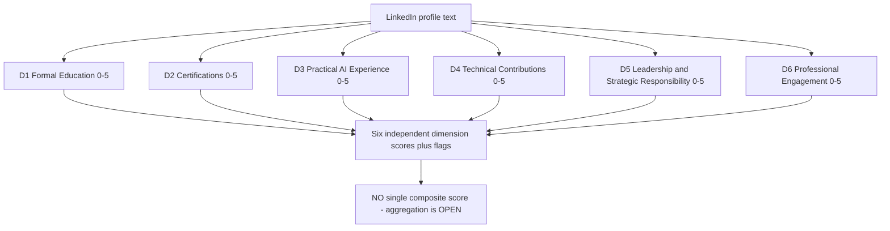
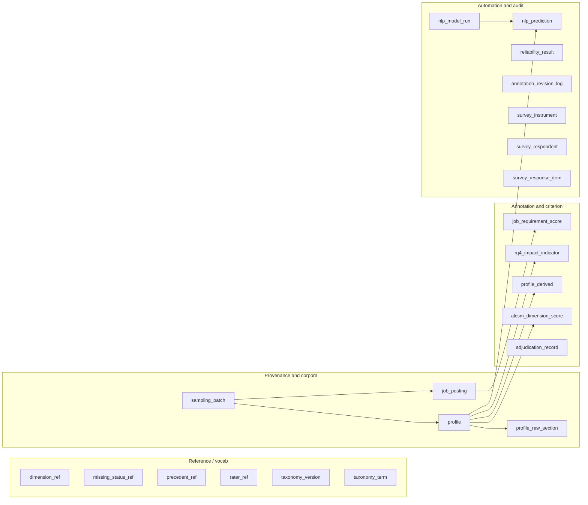
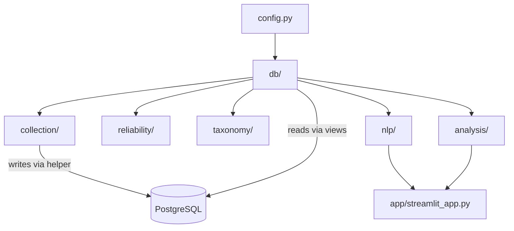
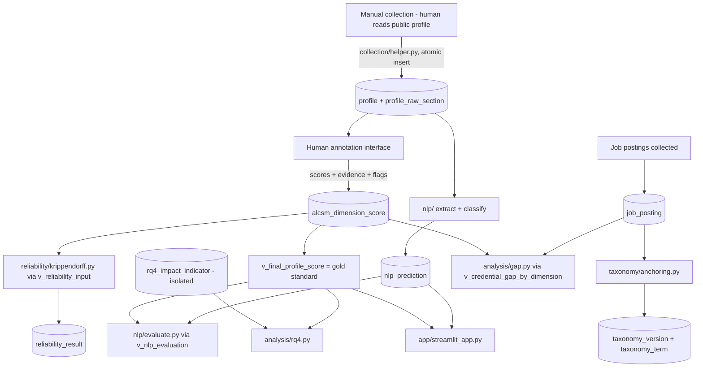

# PROJECT_CONTEXT.md
### Developer Onboarding Handbook — ALCSM Research Software

> **You are reading the single most important context file in this repository.**
> If you are a new engineer (human or Claude Code) joining this project, read this document in full before writing any code. It is self-contained: it assumes you know Python and software engineering but nothing about this research project. It tells you what the project is, what is finished, what is frozen, what is deliberately unfinished, and how to continue safely.
>
> This is **engineering onboarding documentation**, not a thesis document. It is written the way a senior engineer would brief a new teammate on an established codebase. Where research methodology matters to implementation, it is explained in plain engineering terms and cross-referenced to the canonical methodology documents — but this file never *redefines* methodology.

**Document status:** living engineering reference. Consistent with the canonical Tasks 1–5 documentation as of Schema **v1.0.1**.
**Companion files you will also need:** `CLAUDE_CODE_RULES.md` (the eight hard rules), `CLAUDE_CODE_IMPLEMENTATION_GUIDE.md` (technical spec), `Document_Version_Policy.md` (which files are canonical), `Task5_Implementation_Readiness_Checklist.md` (what is ready to build).

---

## Table of contents

1. Executive Overview
2. Project Vision
3. Research Background
4. Thesis Objectives
5. Research Questions (RQ1–RQ5)
6. Complete ALCSM Overview
7. Six Dimensions Explained in Detail
8. Scoring Logic
9. Missing Data Framework
10. Evidence Rules
11. Annotation Principles
12. Precedent Library Overview
13. Database Architecture
14. ER Architecture
15. Database Tables Explained
16. Database Views Explained
17. Database Constraints
18. Repository Folder Structure
19. Purpose of Every Major Folder
20. Technology Stack
21. Python Architecture
22. PostgreSQL Architecture
23. SQLAlchemy Responsibilities
24. Streamlit Architecture
25. NLP Architecture
26. Data Flow Through the System
27. Module Responsibilities
28. Coding Standards
29. Python Style Guide
30. Type Hinting Rules
31. Logging Standards
32. Error Handling Standards
33. Testing Strategy
34. Documentation Standards
35. Git Workflow
36. Commit Message Convention
37. Versioning Strategy
38. Phase-by-Phase Implementation Roadmap (P0–P8)
39. Common Implementation Mistakes
40. Things Claude Code Must Never Do
41. Frozen Methodology Decisions
42. Frozen Database Decisions
43. Frozen Research Decisions
44. Intentionally Open Decisions
45. Security and Privacy Requirements
46. Ethics and GDPR Boundaries
47. Development Workflow
48. Validation Workflow
49. Deployment Strategy
50. Future Work After Thesis Completion

---

## 1. Executive Overview

This repository holds the software for an MSc thesis project called **AI Leadership Credential Gap Analysis (ALCSM)**. In one sentence: **the project scores how strong the AI-leadership credentials are that people show on their LinkedIn profiles, checks how consistently humans and software can produce those scores, and compares them against what AI-leadership job adverts actually ask for.**

The most important idea for you as an engineer to internalise, because it shapes naming, UI copy, and analysis everywhere in the codebase:

> **ALCSM measures the *credential signal a profile presents*, not the person's real ability.** We are auditing what people *show*, not judging who is *good at their job*. Never write code, labels, or outputs that claim to measure "competence", "capability", or "quality of leadership". Use *signal* language.

The research side (the scoring model, the coding rules, the database design) is **finished and frozen**. Your job in the implementation phase is to build the *software* that operates that frozen design: tools to record data, compute reliability statistics, run an NLP pipeline, analyse the results, and present them in a small web app. You are not here to redesign the research. If a task looks like it needs a change to the frozen model or database, that is a signal to **stop and ask the project author**, not to proceed.

A second idea that matters constantly: the database schema is the **single source of truth** for data structure. The schema is defined in one SQL file. Python never invents or alters that structure — it reads and writes through it.

A third: this project processes **real people's personal data** under European data-protection law (GDPR). There are hard rules about where data may live, what may be sent to external services, and what must never be committed to Git. These are not bureaucratic footnotes; violating them is the most serious kind of mistake you can make here.

---

## 2. Project Vision

Job titles like "Chief AI Officer", "Head of AI", and "VP of Machine Learning" have proliferated far faster than any shared understanding of what qualifications such a role requires. The vision behind this project is to bring evidence to that gap: to build a transparent, reproducible way of describing the *credentials people present* for AI-leadership roles, and to measure — at the level of a population of 500 profiles — how those presented credentials line up (or fail to line up) with what employers advertise for.

The deliverable is not a verdict on individuals. It is:

- a **scoring model** (ALCSM) that anyone can apply consistently;
- **evidence** about patterns across a population (e.g. how often a senior AI title sits on top of little visible substantiation);
- a **software tool** that demonstrates the scoring can be automated.

From an engineering standpoint, the vision translates into a system that is *reproducible* (same input, same score, forever), *transparent* (every score traceable to the text that justified it), *privacy-respecting* (personal data tightly controlled), and *honest about uncertainty* (it never presents a single confident number where the research says the truth is multi-dimensional and partly unresolved).

---

## 3. Research Background

You do not need to become a social scientist, but a little background makes the code make sense.

The model rests on **signalling theory** (Spence, 1973): in a labour market where employers cannot directly observe ability, people emit *signals* — degrees, certifications, titles — that are meant to correlate with ability. A "credential gap" is what happens when the signal and the underlying substance diverge: someone holds the title without the things the title is supposed to imply. That is exactly the phenomenon this project measures, and it is why the framing is "signal, not competence" — signalling theory is about the signal.

Other ideas feed specific parts of the model: reputation as an ongoing, renewable signal (Tadelis, 2002) underpins the "engagement" dimension; competency and upper-echelons theory inform the "leadership" dimension; an AI-literacy framework (Ng et al., 2021) informs the "education" dimension. You will see these names in the methodology documents. You do **not** need to read them to write correct code, but you should know they exist and that the dimension definitions are *derived from theory*, not invented arbitrarily — which is part of why they are frozen.

The canonical background is `Literature_Remapping_and_Annotations_v1.md`. The measurement model's formal properties are in `ALCSM_Measurement_Model_and_Validation_Note.md`.

**One property from that note that has direct code consequences:** ALCSM is a **formative composite index**, not a reflective scale. In plain terms: the six dimensions are *distinct constituent parts* of a credential profile, not six interchangeable measurements of one underlying thing. Two consequences you must respect:

1. The dimensions are **not** expected to correlate strongly with each other, and low correlation is *fine* — it is not a bug to be "fixed".
2. You must **never** compute or report Cronbach's alpha (internal-consistency reliability) across the six dimensions. It is the wrong statistic for a formative index and would be a methodological error. (Inter-rater reliability, Krippendorff's alpha per dimension, *is* correct — see §33 and §48.)

---

## 4. Thesis Objectives

The thesis produces three artefacts. Each maps to code you will help build.

| # | Artefact | What it is | Where it lives in the code |
|---|---|---|---|
| 1 | **ALCSM scoring model** | A six-dimension, 0–5 rubric for scoring credential signals | `docs/framework/` (frozen), applied by `collection/`, `nlp/`, `analysis/` |
| 2 | **Credential-gap analysis** | Comparison of *required* credentials (200 job postings) vs. *held* credentials (500 profiles), per dimension | `analysis/gap.py`, view `v_credential_gap_by_dimension` |
| 3 | **NLP screening tool** | A local web app that scores a profile's six dimensions automatically | `nlp/`, `app/streamlit_app.py` |

Everything you build serves one of these three, plus the supporting infrastructure (database access, data collection tooling, reliability computation, taxonomy anchoring).

---

## 5. Research Questions (RQ1–RQ5)

The research questions are the "why" behind each analysis module. They are frozen.

| RQ | Question (engineering paraphrase) | Implemented by |
|---|---|---|
| **RQ1** | What credential patterns exist among AI leaders? | Descriptive analysis over `alcsm_dimension_score` and the dimension-level views |
| **RQ2** | How do job requirements differ from held credentials? | `analysis/gap.py`; `v_credential_gap_by_dimension` (mean required − mean held, per dimension) |
| **RQ3** | How can ALCSM be constructed and validated? | Reliability workflow (`reliability/`) + taxonomy anchoring (`taxonomy/`) |
| **RQ4** | Does credential signal correlate with observable professional-impact indicators? | `analysis/rq4.py`; the isolated `rq4_impact_indicator` table |
| **RQ5** | Can NLP automate credential scoring? | `nlp/` pipeline evaluated against the human gold standard via `v_nlp_evaluation` |

A subtle but important point about **RQ4**: the "impact indicators" (follower reach, post engagement, third-party recognition, seniority-progression rate) are **external validation criteria**, deliberately kept *separate* from the ALCSM dimensions. They are stored in their own table and must never be used as inputs to a dimension score, nor shown to human annotators while they score. Mixing them in would make the validation circular. This separation is enforced structurally in the database and must be respected in every module (see §15, §25, §45).

---

## 6. Complete ALCSM Overview

**ALCSM** = *AI Leadership Credential Scoring Model*. It scores one LinkedIn profile on **six dimensions**, each an integer **0–5**. That's the whole model at a glance. The subtlety is entirely in *how* you assign those scores consistently, which is what the coding rulebook and precedent library govern.



Key properties you must keep true in code:

- **Six dimensions, fixed codes:** `d1_education`, `d2_certifications`, `d3_experience`, `d4_contributions`, `d5_leadership`, `d6_engagement`. Never use ad-hoc names like `education_score`.
- **Scores are ordinal 0–5.** Treat them as ordinal in statistics — a mean is descriptive shorthand only, not an interval quantity.
- **There is no single "ALCSM score".** Aggregation function and weights are deliberately unresolved (see §44). The system reports six dimension scores; it does not collapse them into one number by default.
- **Verifiability differs by dimension.** D1, D2, D4 rest on structured, checkable evidence; D3, D5, D6 rest on self-presentation and are harder to verify. This "verifiability gradient" is a first-class fact, surfaced in the UI and in analysis.

Canonical definition: `docs/framework/ALCSM_Measurement_Specification_v1.0.md`.

---

## 7. Six Dimensions Explained in Detail

Each dimension has a fixed 0–5 rubric. The rubrics below are the frozen scoring criteria. You will encode them in the annotation interface, the NLP classifiers, and the analysis — but you will never change them.

### D1 — Formal Education (`d1_education`) — high verifiability
What academic credentials in AI/quantitative fields the profile shows.

| Score | Criterion |
|---|---|
| 0 | No higher education, or unrelated field |
| 1 | Bachelor's, adjacent field, no AI coursework |
| 2 | Bachelor's in CS/quantitative field, no AI specialisation |
| 3 | Bachelor's with AI specialisation, or Master's in an adjacent field |
| 4 | Master's in AI/ML/Data Science, or PhD in an adjacent quantitative field |
| 5 | PhD in CS/AI/ML with AI-specific research |

### D2 — Professional Certifications (`d2_certifications`) — high verifiability
Vendor/professional certifications, weighted by AI-specificity, issuer credibility, and currency.

| Score | Criterion |
|---|---|
| 0 | None listed |
| 1 | One expired or low-credibility certification |
| 2 | One current certification from a recognised vendor |
| 3 | Two or more current general certifications |
| 4 | Multiple current AI/ML-specific certifications |
| 5 | Multiple AI/ML certifications plus a maintained professional-body credential |

### D3 — Practical AI Experience (`d3_experience`) — medium verifiability
Self-described applied AI/ML role history; distinguishes AI-core roles from adjacent ones, and ownership language from peripheral language.

| Score | Criterion |
|---|---|
| 0 | No AI/ML roles |
| 1 | AI-adjacent role only |
| 2 | 1–2 years in an explicit AI role, individual-contributor scope |
| 3 | 3+ years in AI, or 1–2 years with clear ownership language |
| 4 | Multi-year, multi-role with ownership escalation |
| 5 | Sustained AI leadership with systems deployed at scale |

### D4 — Technical Contributions (`d4_contributions`) — medium–high verifiability
Publications, patents, open-source work, technical talks. **This is the only dimension where external verification is allowed** (checking a linked GitHub, a public index) — and even then verification may only *confirm or lower* a score, never raise it above what the profile text supports.

| Score | Criterion |
|---|---|
| 0 | None discoverable |
| 1 | Non-technical public content only |
| 2 | One verifiable technical artefact |
| 3 | Multiple artefacts, unverified |
| 4 | Multiple artefacts, at least one externally verifiable |
| 5 | Sustained, externally verifiable output (publications/patents/high-engagement OSS) |

### D5 — Leadership & Strategic Responsibility (`d5_leadership`) — low verifiability
Positional seniority plus strategic-scope language. **This is the weakest dimension for verifiability** — titles are self-assigned and company-specific, and the cognitive facet of leadership cannot be read from static text. Code and UI must not imply this dimension measures leadership *ability*.

| Score | Criterion |
|---|---|
| 0 | Individual contributor, no leadership language |
| 1 | Team lead / informal only |
| 2 | Manager-level, team scope |
| 3 | Director/Head with some strategic language |
| 4 | VP/senior with explicit enterprise-strategy responsibility |
| 5 | C-level with strategic *and* augmentation-aware framing |

### D6 — Professional Engagement & Continuous Development (`d6_engagement`) — low–medium verifiability
Ongoing activity: original posts, community roles, continuing education. Confounded by platform-usage habits (some strong people simply don't post), which is a known limitation to disclose, not to "correct".

| Score | Criterion |
|---|---|
| 0 | No visible engagement |
| 1 | Passive engagement (likes/shares) only |
| 2 | Regular passive engagement, no original content |
| 3 | Occasional original commentary |
| 4 | Regular original commentary plus community membership |
| 5 | Sustained thought leadership plus a community leadership role |

Full detail, including the eight supporting taxonomies (degree, certification, AI-role, leadership-level, technical-contribution, engagement, AI-keyword ontology, automation/augmentation vocabulary): `docs/framework/ALCSM_Measurement_Specification_v1.0.md`.

---

## 8. Scoring Logic

The scoring logic is deliberately simple at the top and disciplined underneath.

- Each dimension gets **one integer 0–5**, assigned by applying that dimension's rubric (§7) to the evidence in the profile.
- **No half-scores, no averaging within a dimension.** If two adjacent scores both seem plausible, you record both as candidates and assign the **lower** one (the "default-low" rule — the study audits credential *gaps*, so under-crediting is the safer error).
- **No cross-dimension halo.** A strong PhD (D1) must not raise the Leadership score (D5). Each dimension is judged only on its own evidence.
- **Keyword presence never sets a score.** The AI-keyword ontology is used only to *locate* relevant text; a profile stuffed with forty AI buzzwords does not thereby score higher (that would reward exactly the inflation the study detects).
- **There is no composite.** The system does not, by default, combine the six into one number. Aggregation (how to weight and combine) is an *open* research question (§44); any aggregated view in the app is explicitly labelled exploratory and lets the user compare candidate methods — never a single hard-coded number.

Canonical: `docs/framework/ALCSM_v1.0_Scoring_Framework_Task3.md`.

---

## 9. Missing Data Framework

This is one of the most important and most error-prone parts of the whole system. There are **four** missing-data states, and confusing two of them corrupts the analysis. Memorise this table.

| State | Meaning | Typical score | Counts as "informative"? | Where valid |
|---|---|---|---|---|
| `present` | Evidence exists; scored on its merits | 0–5 | Yes | profiles & postings |
| `absent_stated` | The profile **positively states** the credential is absent (e.g. "self-taught, no formal AI degree") | usually low | **Yes** — it is a claim, not a gap | profiles & postings |
| `unavailable` | No evidence found: section empty, absent, or not retrieved | 0 | No | profiles & postings |
| `not_applicable` | The dimension does not apply to this record | — | No | **job postings only** |

The critical distinction: **`absent_stated` vs `unavailable`.** "I have no certifications, I'm self-taught" is a *stated absence* — informative data. A blank certifications section is *missing* data. They must never be pooled. This distinction is why the database stores raw profile sections in "long format" with an explicit `section_available` flag (see §15) — so that "empty" and "not retrieved" can never collapse into an ambiguous NULL.

The **completeness index** for a profile = (dimensions that are `present` or `absent_stated`) ÷ 6. Note the denominator is always **6**, not "the number of dimensions scored" — a bug in an earlier version divided by the wrong denominator and made a partially-coded profile look fully documented; it was fixed in schema v1.0.1 (correction F-01). Do not reintroduce that bug.

`not_applicable` on the job-postings side must be **excluded** from the credential-gap calculation, never read as "required level 0" — a posting that is silent about certifications is not a posting requiring zero certifications.

Canonical: `docs/framework/ALCSM_v1.0_Implementation_Readiness_Specification.md` (missing-data policy).

---

## 10. Evidence Rules

Every score must be *traceable*. These rules are enforced partly by the database and partly by discipline.

- **Every `present` score cites a verbatim evidence span.** No span, no score. The database rejects a `present` score with no evidence text.
- **Quote, don't paraphrase, in the evidence field.** Your interpretation goes into the score; the raw words go into the evidence, so a reviewer can check your reasoning.
- **One artefact can support two dimensions but maximises neither.** A "deployed ML in production" line is evidence for both D3 (experience) and D4 (contribution); score each on its own rubric, don't let one item inflate both.
- **Following a profile-provided link is within-profile evidence** (allowed for any dimension). **Searching the web for corroboration is "external verification"** — allowed for **D4 only**, and only to confirm or lower, never to raise beyond what the text supports. This boundary is enforced by a database constraint.

---

## 11. Annotation Principles

Human coders ("annotators") produce the *gold-standard* scores that the NLP pipeline is later measured against. The full rules live in `docs/rulebook/ALCSM_Annotation_Handbook.md`; here is what an engineer needs to know to build the tooling correctly.

The annotation interface you will build (Phase P4) **must** enforce four constraints — these are not preferences, they protect the validity of the data:

1. **Show one profile's six dimensions together**, and score all six before moving on (prevents "code all D1s in a row" bias).
2. **Never display the RQ4 impact values during scoring** (prevents predictor/criterion contamination — see §5, §45).
3. **Blind the two raters to each other** until both submit (independence is required for the reliability statistics to mean anything).
4. **Capture, per dimension:** score, verbatim evidence, missing-status, ambiguity/contradiction flags, precedent applied, and — for D4 only — verification metadata.

The single hardest judgement an annotator makes, and therefore the thing your examples and tests should exercise most, is telling apart three superficially similar situations: **credential inflation** (a senior title with nothing behind it), an **under-signalled expert** (strong verifiable work but few certs/posts), and a **legitimately narrow leader** (real substantiated scope but thin technical output). They can produce similar-looking low scores for opposite reasons, and distinguishing them is the whole point of the exercise.

---

## 12. Precedent Library Overview

To keep coding consistent across annotators and over time, the project maintains a **precedent library** of fifteen binding rulings, `P-01` through `P-15`. When a live case matches a precedent, the annotator applies the ruling rather than re-deciding, and records the precedent ID. The database has a `precedent_ref` table and every score row can reference the precedent that governed it.

| ID | Situation | Ruling (short) |
|---|---|---|
| P-01 | Field on a taxonomy tier boundary | Default-low; flag ambiguity; escalate only if raters differ |
| P-02 | "Head of X" with no scope language | Score Director-equivalent (Tier 3), not VP (Tier 4) |
| P-03 | Senior title, nothing substantiating it | Title alone must not push D5 above 2; set contradiction flag |
| P-04 | Strong tech, low certs/leadership/engagement | Score honestly; no positive halo; keep the lows |
| P-05 | Substantiated leader, thin technical depth | High D5 with low D4 is legitimate — not a contradiction |
| P-06 | Certification from an unrecognised issuer | Low-credibility tier |
| P-07 | Long career, short AI-specific tenure | Score D3 on AI-relevant experience only |
| P-08 | Adjacent-field expert (data eng., general SWE) | Adjacent band for D3; resist halo |
| P-09 | Keyword-stuffed profile, no substance | Ontology locates, never scores; flag contradiction |
| P-10 | Headline claim contradicts dated experience | Prefer dated evidence; flag contradiction |
| P-11 | Non-English / untranslatable credential | Map if defensible, else default-low, log verbatim |
| P-12 | One artefact evidences two dimensions | Each dimension on its own criterion; no double-inflation |
| P-13 | Stated absence vs missing | `absent_stated` (score it) vs `unavailable` (missing) |
| P-14 | Profile-provided link | Within-profile evidence (any dim); web search is D4-only |
| P-15 | Verification reveals an overstated claim | May lower (D4 only), never raise above the text |

You will load these fifteen rulings — **with their real text**, not placeholders — into `precedent_ref` during Phase P0. Do not invent new precedents in code; new precedents are a research decision made by the author through the revision log.

---

## 13. Database Architecture

PostgreSQL 16. The schema is **frozen at v1.0.1** and defined entirely in one file: **`schema/alcsm_schema_v1.0.1.sql`**. That file is the *single source of truth* for structure. It was validated on a live PostgreSQL 16 instance with a 67-test harness; every deliberate rule-violation was rejected.

At a glance: **22 base tables, 5 views, 33 foreign keys (all `ON DELETE RESTRICT`), and a large set of CHECK constraints** that encode the research rules directly in the database so they cannot silently erode over hundreds of records.

The governing design principle: **enforce frozen rules in the database wherever a constraint can express them.** A rule written only in a document degrades over time and across people; a `CHECK` constraint does not.



Canonical: `Task4c_ER_Design_Documentation.md`, `PATCH_NOTES_v1.0.1.md`.

---

## 14. ER Architecture

The entity-relationship structure has four layers and a small number of load-bearing relationships. The full diagram is `alcsm_er_diagram.mermaid` (22 entities, 33 relationships, verified against the live catalogue). The relationships you will touch most:

- `sampling_batch (1) → (many) profile` and `→ (many) job_posting` — every collected record traces back to the documented search that found it (provenance).
- `profile (1) → (many) profile_raw_section` — a profile decomposes into up to seven named text sections, each with an availability flag.
- `profile (1) → (many) alcsm_dimension_score` — one row per profile × dimension × rater (plus adjudication rows).
- `profile (1) → (0..1) profile_derived` and `→ (0..1) rq4_impact_indicator` — one-to-one satellites (shared primary key enforces "at most one").
- `dimension_ref (1) → (many)` across scores, requirements, predictions, reliability results — one authoritative definition of the six dimensions, reused everywhere.
- `nlp_model_run (1) → (many) nlp_prediction` — every prediction traces to a seeded, versioned run.

A relationship that is **deliberately absent**: there is no link between `survey_respondent` and `profile`. Expert survey respondents and audited profiles are separate populations; linking them would wrongly imply the survey evaluates specific individuals.

---

## 15. Database Tables Explained

The 22 tables, grouped by purpose. You will not touch all of them in early phases, but you should know what each is for.

### Reference / controlled vocabulary
| Table | Purpose |
|---|---|
| `dimension_ref` | The six dimensions: number, code, label, verifiability tier, and whether external verification is permitted (TRUE for D4 only). Fixed at 6 rows. |
| `missing_status_ref` | The four missing-data states and their properties (`counts_as_informative`, `include_in_gap`). Fixed at 4 rows. |
| `precedent_ref` | The fifteen binding precedents P-01…P-15. |
| `rater_ref` | Annotators and their roles (`primary`, `secondary`, `adjudicator`), plus a bias-control disclosure flag. |
| `taxonomy_version` | Versioned instances of the eight taxonomies; carries `frozen` and the batch it was anchored to. |
| `taxonomy_term` | The term lists belonging to a taxonomy version, with observed frequency (from anchoring). |

### Provenance and corpora
| Table | Purpose |
|---|---|
| `sampling_batch` | One documented, reproducible search. Provenance root for both corpora. |
| `profile` | One pseudonymous LinkedIn profile. **No name, URL, photo, or contact detail is ever stored.** Carries provenance and an `activity_data_collected` ethics flag. |
| `profile_raw_section` | Verbatim text of one profile section (`headline`, `about`, `experience`, `education`, `certifications`, `contributions`, `activity`), with an explicit `section_available` boolean. **Long-format on purpose** (see §9). |
| `job_posting` | One job posting with full `raw_posting_text` retained (needed for taxonomy anchoring). |

### Annotation, criterion, adjudication
| Table | Purpose |
|---|---|
| `alcsm_dimension_score` | The core scoring table: one row per profile × dimension × rater. Holds score, evidence, missing-status, flags, precedent, verification metadata, versions, and an `is_adjudication` marker. |
| `job_requirement_score` | The posting-side parallel: *required* level per dimension. **Separate table on purpose** — required ≠ held. |
| `profile_derived` | Computed per-profile flags: `completeness_index`, `title_substance_contradiction_flag`, `adjudicated`, `double_coded`. Recomputed, never hand-edited. |
| `rq4_impact_indicator` | The RQ4 external criterion variables (network reach, engagement, recognition count, seniority-progression rate). **Physically isolated** from scores; never shown to raters. |
| `adjudication_record` | The audit trail of a resolved disagreement: both raters' scores, a generated disagreement magnitude, resolution route, final score, adjudicator, and reason. |

### Automation and audit
| Table | Purpose |
|---|---|
| `nlp_model_run` | One pipeline execution: model name/version, random seed, code commit hash, and the `information_base` it used. |
| `nlp_prediction` | One model-predicted dimension score, tied to a run. |
| `reliability_result` | Stored per-dimension reliability statistics (α, bootstrap CI bounds, % agreement, n, variance). |
| `annotation_revision_log` | Audit trail of any rulebook-wording revision. |
| `survey_instrument` / `survey_respondent` / `survey_response_item` | The expert-validation survey (consent-based; supports content validity). |

**No table anywhere stores a composite ALCSM score, weight, or classification band.** That absence is deliberate and must be preserved (see §44).

---

## 16. Database Views Explained

Five views encode frozen rules so that analysis code physically cannot violate them. **Always read through the relevant view; never hand-roll the equivalent query against base tables.**

| View | What it does | Rule it protects |
|---|---|---|
| `v_reliability_input` | Returns only independent, **pre-adjudication** rows from `primary`/`secondary` raters | Reliability must be computed on independent judgements; including adjudicated rows would inflate agreement |
| `v_final_profile_score` | One analysis-ready row per profile × dimension; the adjudicated value wins where one exists | Consistent "final" score selection |
| `v_profile_completeness` | `completeness_index` = informative ÷ **6**, plus a `coding_complete` flag | Correct completeness denominator (F-01 fix) |
| `v_credential_gap_by_dimension` | Mean required − mean held, per dimension, **excluding** `not_applicable`/`unavailable` | Gap is computed only over comparable data, never treating silence as zero |
| `v_nlp_evaluation` | Joins predictions to the human gold standard; exposes signed/absolute error and exact-match per profile × dimension | NLP is evaluated per dimension against the same information base |

---

## 17. Database Constraints

The schema encodes research rules as constraints. You will meet these when an insert is rejected — that rejection is usually the schema protecting the research, not a bug. The important ones:

- **Score range:** every score is `CHECK (score BETWEEN 0 AND 5)`.
- **Verification is D4-only:** `verification_used` may be TRUE only when `dimension_number = 4`.
- **Evidence required when present:** a `present` score must have evidence text.
- **`unavailable` implies score 0 and no evidence;** **`absent_stated` requires evidence** (a positive claim). (Coherence constraints, added in v1.0.1: F-04.)
- **Ambiguity brackets the score:** if the ambiguity flag is set, the assigned score must lie within the recorded candidate range (F-05).
- **Adjudication role alignment:** `is_adjudication = TRUE` iff the rater is the adjudicator (F-02) — prevents a primary rater's row being silently dropped from reliability.
- **Tie-break routing:** a disagreement of magnitude ≥ 2 must be `escalated`, not resolved by "consensus" (F-03).
- **One score per grain:** unique on (profile, dimension, rater, rulebook_version) — prevents duplicate coding while allowing legitimate re-coding under a revised rulebook.
- **No cascading deletes:** all 33 foreign keys are `ON DELETE RESTRICT`; research data cannot be destroyed as a side effect.

The v1.0.1 constraints F-01…F-05 are documented in `PATCH_NOTES_v1.0.1.md`. Three further hardening items (F-06 taxonomy NOT NULL, F-07 hygiene, F-08 activity/ethics trigger) are **deferred** — see `alcsm_optional_recommendations.sql` — and are enabled on schedule, not now (F-06 after taxonomy anchoring, F-08 after ethics). Their absence is not a defect.

---

## 18. Repository Folder Structure

```
alcsm-thesis/
├── PROJECT_CONTEXT.md                    ← this file (read first)
├── CLAUDE_CODE_IMPLEMENTATION_GUIDE.md   ← technical spec
├── CLAUDE_CODE_RULES.md                  ← eight hard rules
├── README.md                             ← short orientation
├── Document_Version_Policy.md            ← canonical vs archived files
├── Task5_Implementation_Readiness_Checklist.md
├── pyproject.toml                        ← deps + tooling (Python 3.11+)
├── .gitignore                            ← MUST exclude data/, .env, secrets
├── .env.example                          ← config template (no real secrets)
│
├── docs/
│   ├── framework/    ← FROZEN: spec, scoring framework, validation note, design decisions
│   ├── rulebook/     ← FROZEN: annotation handbook, coding rulebook, precedents
│   ├── ethics/       ← ethics application, approvals, privacy notice
│   ├── gdpr/         ← LIA, DPIA, Data Management Plan
│   └── protocols/    ← sampling, collection, reliability protocols
│
├── schema/
│   ├── alcsm_schema_v1.0.1.sql           ← SINGLE SOURCE OF TRUTH
│   ├── alcsm_patch_v1.0.0_to_v1.0.1.sql  ← upgrade path only
│   └── alcsm_optional_recommendations.sql← deferred F-06/F-07/F-08
│
├── src/alcsm/
│   ├── config.py
│   ├── db/          engine.py · models.py · queries.py
│   ├── collection/  helper.py
│   ├── reliability/ krippendorff.py
│   ├── taxonomy/    anchoring.py
│   ├── nlp/         extract.py · classify.py · evaluate.py
│   ├── analysis/    gap.py · rq4.py
│   └── app/         streamlit_app.py
│
├── tests/           ← pytest, mirrors src/alcsm/
├── scripts/         ← backup_alcsm.sh, validation harness
├── Archive/         ← superseded files (retained, never used)
└── data/            ← GITIGNORED. Real data lives in the SECURE STORE, not here.
```

---

## 19. Purpose of Every Major Folder

| Folder | Purpose | May you change freely? |
|---|---|---|
| `docs/framework/`, `docs/rulebook/` | The frozen research design | **No** — frozen; edits need author approval |
| `docs/ethics/`, `docs/gdpr/` | Governance artefacts | Add approvals/notes; don't invent policy |
| `schema/` | The database DDL — source of truth | **No** — schema changes need approval |
| `src/alcsm/` | The application code you build | **Yes** — within the architecture and rules |
| `tests/` | pytest suite | **Yes** — and required for every module |
| `scripts/` | Operational scripts (backup, validation) | Yes |
| `Archive/` | Superseded files, retained for history | Never run or edit; never resurrect a canonical from here |
| `data/` | Local, **non-personal** fixtures only | Never commit; real personal data never goes here |

---

## 20. Technology Stack

| Layer | Choice | Notes |
|---|---|---|
| Language | **Python 3.11+** | Type hints throughout |
| Database | **PostgreSQL 16** | Schema is the source of truth |
| DB driver | **psycopg2** | Used by the validated collection helper |
| ORM | **SQLAlchemy** | **Application layer only** — never defines or migrates schema (§23) |
| NLP | **spaCy, sentence-transformers, HuggingFace** | **Local models only** — no external APIs on profile text (§25, §45) |
| App | **Streamlit** | Local screening tool (§24) |
| Stats | numpy / scipy / a Krippendorff implementation | Ordinal-appropriate methods |
| Tooling | black, ruff, mypy, pytest | Formatting, lint, types, tests |
| Packaging | `pyproject.toml` | Single dependency/config file |

Developer environment target (from the author's setup): macOS (Apple Silicon), zsh, Docker available for running PostgreSQL locally.

---

## 21. Python Architecture

The code under `src/alcsm/` is organised by responsibility, with a strict rule that **structure lives in the database and behaviour lives in Python**. No Python module creates or alters tables.



Each module is small, single-purpose, independently testable, and depends on `db/` for access. Cross-module coupling is minimised: `analysis/` reads through views; `nlp/` writes predictions; `collection/` is the one write path for profiles.

---

## 22. PostgreSQL Architecture

- **The DDL file is authoritative.** Deploy a fresh database from `schema/alcsm_schema_v1.0.1.sql`. Never create tables from Python.
- **Reference data** (6 dimensions, 4 missing states, 15 precedents with real text, raters) is loaded once at setup.
- **Read through views** for anything the views cover (§16).
- **Every write carries versions** (`alcsm_version`, `rulebook_version`, `taxonomy_version_id`, model/run ids) for reproducibility.
- **Local development** runs PostgreSQL in Docker; **production/real data** runs on the approved, access-controlled, EEA-resident secure store (§45). The two are the same schema, different hosts.

---

## 23. SQLAlchemy Responsibilities

SQLAlchemy is present for ergonomic reads and typed access. Its responsibilities are deliberately narrow.

**SQLAlchemy MUST:**
- Provide the engine/session and connection lifecycle (`db/engine.py`).
- Offer models **reflected from** the deployed schema (Core or `automap`), and read queries over the views (`db/queries.py`).

**SQLAlchemy MUST NOT:**
- Define tables declaratively and call `create_all()`.
- Run migrations (no Alembic against the research database).
- Be the write path for profile collection — that is the psycopg2-based `collection/helper.py`, which stays the single authoritative insertion path. If the helper is ever ported onto SQLAlchemy Core, the psycopg2 version is retired in the same change; two write paths must never coexist.

If reflected models and the live schema ever disagree, **fail fast** — never "fix" the database to match the code. The database is right by definition.

---

## 24. Streamlit Architecture

The Streamlit app (`app/streamlit_app.py`) is the RQ5 demonstration tool: paste/enter a profile's text, get its six dimension scores, transparently.

**The dashboard must display:**
1. the six ALCSM dimension scores (0–5 each);
2. missingness status per dimension;
3. the completeness index;
4. evidence summaries (the spans supporting each score);
5. validation indicators (ambiguity/contradiction flags; NLP confidence where available).

**The dashboard must NOT display a single ALCSM composite score.** Aggregation is exploratory until empirically validated. If any aggregated view is offered, it is a clearly-labelled panel comparing the candidate aggregation methods — never one number presented as "the ALCSM score". No RQ4 impact values are shown as if they were part of ALCSM. Signal language throughout. No browser storage of personal data.

---

## 25. NLP Architecture

The NLP pipeline (`nlp/`) automates the six-dimension scoring so it can be compared against the human gold standard (RQ5).

**Hard privacy rule:** **no external-API processing of LinkedIn profile text.** Profile text is never sent to a hosted/third-party LLM or NLP API. Use **local models only** — spaCy, sentence-transformers, and locally-run HuggingFace models — on the approved infrastructure. This is a GDPR requirement, not a preference (§45).

**Comparability rule:** the pipeline operates on the *same information base* as the human coders (profile text only, unless links are explicitly in scope), and records that on each `nlp_model_run`.

Stages:
1. **`extract.py`** — parse `profile_raw_section` text into per-dimension features; the AI-keyword ontology *locates* evidence (never scores it).
2. **`classify.py`** — six ordinal 0–5 predictors. Start simple (spaCy + local embeddings + an ordinal classifier); escalate only with justification and only with local models. Record `predicted_score`, optional confidence, `predicted_missing_status`.
3. **`evaluate.py`** — compare predictions to the gold standard via `v_nlp_evaluation`, per dimension, with ordinal-appropriate metrics; fix `random_seed`, record `code_commit_hash`.

The pipeline cannot be trained until a human gold standard exists (Phase P6) and taxonomies are anchored (P3). Do not train earlier.

---

## 26. Data Flow Through the System



Read the flow as: collect → anchor taxonomies → annotate (produces the gold standard) → compute reliability → run NLP and evaluate against the gold standard → analyse gap and RQ4 → present in the app. The `rq4_impact_indicator` table sits off to the side, feeding only the RQ4 analysis, never the scoring.

---

## 27. Module Responsibilities

| Module | Responsibility | Must never |
|---|---|---|
| `config.py` | Typed settings from environment | Hard-code secrets or DSNs |
| `db/engine.py` | Engine/session lifecycle | Define or migrate schema |
| `db/models.py` | Reflected models aligned to the DDL | Create/alter tables |
| `db/queries.py` | Reads through the frozen views | Bypass `v_reliability_input` for reliability |
| `collection/helper.py` | Validated, atomic, privacy-enforcing inserts | Scrape LinkedIn; be duplicated by an ORM path |
| `reliability/krippendorff.py` | Per-dimension α + bootstrap CI + % agreement + variance | Pool dimensions; use adjudicated rows; compute Cronbach's α |
| `taxonomy/anchoring.py` | Seed term lists from postings; stamp versions | Invent unevidenced terms; edit a frozen version |
| `nlp/*` | Extract → classify → evaluate, per dimension | Use info the human coder couldn't see; call external APIs on profile text |
| `analysis/gap.py` | Credential gap via the view | Treat silence as zero |
| `analysis/rq4.py` | Ordinal correlation with impact indicators | Use an ALCSM dimension as a criterion (circularity) |
| `app/streamlit_app.py` | Six-dimension screening tool | Show a single composite; show RQ4 values as ALCSM |

---

## 28. Coding Standards

- **Formatting:** `black` (line length default). **Linting:** `ruff`. **Types:** `mypy` where practical.
- **Naming:** modules and functions `snake_case`; classes `PascalCase`; the six dimensions always referenced by their fixed codes (`d1_education`…`d6_engagement`), never by ad-hoc names.
- **Functions small and single-purpose;** prefer pure functions for scoring/statistics so they are trivially testable.
- **No magic numbers for scores;** the 0–5 range and dimension codes come from `dimension_ref`/config, not scattered literals.
- **Comments explain *why*, and cite the governing frozen rule** where a line exists to satisfy one (e.g. `# D4-only verification, see spec §2.5`).

---

## 29. Python Style Guide

- Follow **PEP 8**, enforced by black + ruff.
- One public responsibility per module; keep functions under ~40 lines where reasonable.
- Prefer explicit over clever. This is research software that must be auditable by a non-specialist examiner; readability beats micro-optimisation.
- Use dataclasses or typed dicts for structured records (e.g. a profile record passed to the collection helper).
- Avoid global mutable state; pass connections/sessions explicitly.
- I/O at the edges, pure logic in the middle: parsing/scoring functions take data in and return data out, so tests need no database.

---

## 30. Type Hinting Rules

- **All public functions are fully type-hinted** (arguments and return).
- Use precise types: `int` for scores (with runtime validation that they're 0–5), `Literal["present","absent_stated","unavailable","not_applicable"]` for missing-status, `Literal[...]` for the six dimension codes.
- Prefer `TypedDict` or dataclasses for record shapes crossing module boundaries.
- Run `mypy` in CI-style checks before committing non-trivial modules.
- Types are documentation: a correctly-typed signature should make misuse (e.g. passing a float score) a static error.

---

## 31. Logging Standards

- Use the standard `logging` module; configure once in `config.py`.
- **Never log personal data.** Profile text, evidence spans, and any identifier must not appear at INFO or above. If you must log an error involving a record, log the `profile_id` (a pseudonym like `PRF-00042`) and nothing else from the record.
- Log level guidance: DEBUG for developer tracing (still no personal data), INFO for lifecycle events (batch started, N records processed), WARNING for recoverable anomalies, ERROR for failures needing attention.
- Structured/context logging (e.g. including `pipeline_run_id`) is encouraged for the NLP and reliability runs, for reproducibility.

---

## 32. Error Handling Standards

The template for correct error handling already exists in `collection_helper.py`: **validate first, then do the work in a transaction, and roll back the whole thing on any error.** A failed operation leaves *no* partial rows, so retrying is always safe.

- **Fail loud and atomic.** Do not swallow exceptions to "keep going"; a half-written record is worse than a clean failure.
- **Validate before touching the database,** returning readable messages, so a human data-entry mistake is caught as "forbidden identifier field: name" rather than as a raw constraint violation mid-transaction.
- **Never let an exception leak personal data** into a log or a Streamlit stack trace. Catch, scrub, and present a clean message.
- **A rejected insert is often correct behaviour** — the schema protecting a research rule. Investigate the constraint before assuming a bug.

---

## 33. Testing Strategy

- **`pytest`, mirroring `src/alcsm/`.** Every module ships with tests of its core logic.
- **No real personal data in tests, ever.** Use constructed fixtures — the eighteen worked example profiles in the annotation handbook are the model.
- **Test against the specification, not the implementation.** This is a hard-won lesson: during Task 4, a test asserted the *buggy* behaviour of the completeness view and therefore "passed" while the code was wrong. Write assertions from the frozen rules, not from what the code currently does.
- **Schema smoke test:** deploying `alcsm_schema_v1.0.1.sql` to a throwaway database and running the validation harness (67 tests) is the required check for any new environment.
- **Reliability maths** tested against small hand-worked cases with known α.
- **NLP evaluation** tested on a tiny fixture with known gold scores.
- Aim for meaningful coverage of logic, not a coverage-percentage vanity metric.

---

## 34. Documentation Standards

- **Docstrings on every public function**, stating inputs, outputs, and any frozen rule the function enforces, with a cross-reference (e.g. "enforces the D4-only verification rule").
- **Keep docs and code in the same commit.** When a module produces something that will appear in the thesis, write the short note then, in signal language, citing the governing frozen document.
- **Edit only canonical files** (`Document_Version_Policy.md`); never edit an archived file, and never let two files claim to be canonical.
- This `PROJECT_CONTEXT.md` is updated when architecture changes — but never to record a change to a frozen decision (those require author approval and a version bump, not a doc edit).

---

## 35. Git Workflow

- **Git holds code, schema, and docs — never personal data.** Verify `.gitignore` excludes `data/`, `.env`, and secrets *before the first commit*.
- **`main` is always runnable.** Use short-lived feature branches per module or per roadmap phase; merge when tests pass.
- **Tag frozen states:** `framework-v1.0`, `schema-v1.0.1`. NLP runs record the commit hash, so keep history clean.
- **Superseded files** move to `Archive/`, out of the working path but retained in history.
- **Pre-commit discipline:** run black/ruff/mypy/pytest; scan for accidental secrets or data before pushing.

---

## 36. Commit Message Convention

Use conventional, scannable messages:

```
<type>(<scope>): <imperative summary>

<body: what and why, referencing the guide section or frozen rule if relevant>
```

- **types:** `feat`, `fix`, `test`, `docs`, `refactor`, `chore`, `data-safety`.
- **scope:** the module or area (`db`, `collection`, `nlp`, `reliability`, `analysis`, `app`, `schema-deploy`).
- Examples:
  - `feat(collection): port atomic profile insert helper with validators`
  - `test(reliability): per-dimension krippendorff alpha against hand-worked cases`
  - `docs(nlp): record local-only model constraint and rationale`
- Never reference or include personal data in a commit message.

---

## 37. Versioning Strategy

- **Schema** is versioned in the filename: current `v1.0.1`. A structural change (author-approved) increments it and moves the prior file to `Archive/`.
- **Framework** is `v1.0` and frozen; changes to *wording/examples* go through the revision log without a framework version bump; changes to *criteria/dimensions* would require an explicit author decision and a version bump.
- **Application code** follows the repository's Git tags; NLP models carry their own `model_version`.
- **The rule that ties it together:** every scored/predicted/collected row records the versions in force when it was produced, so any result is reconstructable.

---

## 38. Phase-by-Phase Implementation Roadmap (P0–P8)

| Phase | Goal | Depends on | Touches real data? |
|---|---|---|---|
| **P0** | Environment: init repo, `.gitignore`, `pyproject.toml`, deploy schema to dev PostgreSQL, run the 67-test harness, load reference data, tag frozen states | — | No |
| **P1** | Collection tooling: port + test `collection/helper.py` against constructed fixtures; verify backup script | P0 | No (fixtures only) |
| **P2** | Governance: ethics / GDPR / DPIA approval | (external) | Gates everything below |
| **P3** | Job postings + taxonomy anchoring: collect ~200 postings, seed term lists, stamp `taxonomy_version`, then enable F-06 | P2 | Yes (postings) |
| **P4** | Annotation interface (four constraints) + pilot coding | P2, P3 | Yes |
| **P5** | Reliability: per-dimension α + CIs + variance into `reliability_result` | P4 | Yes |
| **P6** | Main collection + coding: 500 profiles, sustained reliability; produces the gold standard | P5 gate | Yes |
| **P7** | NLP pipeline: extract/classify/evaluate vs. gold standard | P6 | Yes |
| **P8** | Analysis + app: gap (RQ2), RQ4 correlation, RQ1 patterns; Streamlit tool | P6, P7 | Yes |

**Non-negotiable ordering:** no real profile data before **P2**; no scoring before taxonomies are anchored (**P3**); no NLP training before a gold standard exists (**P6**). Non-personal-data work (P0, P1, and scaffolding of later modules with fixtures) may proceed at any time, including in parallel with the P2 approval wait.

Canonical roadmap detail: `Task5_Implementation_Plan.md`, `Task5_Implementation_Readiness_Checklist.md`.

---

## 39. Common Implementation Mistakes

Learn from these; several actually happened during earlier tasks.

1. **Confusing `absent_stated` with `unavailable`.** They look similar and mean opposite things. A blank section is missing; a stated "I have no X" is data. Get this wrong and the missingness analysis is wrong.
2. **Dividing the completeness index by "dimensions scored" instead of 6.** This was a real bug (fixed as F-01). A partially-coded profile then looks fully documented.
3. **Writing tests against the code instead of the spec.** A test that encodes the current (buggy) behaviour passes while the code is wrong. Write from the frozen rules.
4. **Adding a composite/total score column or a single dashboard number.** Aggregation is open; a hard-coded composite silently commits the research to one method.
5. **Letting a strong dimension inflate a weak one (halo).** Each dimension is scored only on its own evidence.
6. **Using a keyword count to raise a score.** The ontology locates evidence; it never scores.
7. **Treating a job posting's silence about a dimension as "requires 0".** `not_applicable` is excluded from the gap, not read as zero.
8. **Sending profile text to an external API** for convenience. Prohibited — local models only.
9. **Committing personal data or a `.env`** because `.gitignore` wasn't checked first.
10. **Overwriting a rater's score with the adjudicated value.** Adjudication is additive; overwriting destroys the disagreements that reliability is computed from.
11. **Computing Cronbach's alpha across dimensions.** Wrong statistic for a formative index.

---

## 40. Things Claude Code Must Never Do

This is the short, absolute list. If a task requires any of these, **stop and ask the author.** (The fuller version is `CLAUDE_CODE_RULES.md`.)

1. Never modify the ALCSM methodology (dimensions, criteria, rules, precedents, taxonomies' structure, research questions).
2. Never change the database schema (no table/column/constraint/view added, altered, or removed). Never add a composite/total/weight/band column.
3. Never treat anything but `alcsm_schema_v1.0.1.sql` as the schema authority; never let SQLAlchemy define or migrate the schema.
4. Never make an architectural change (new write path, new external dependency, migration tool, external processing step) without approval.
5. Never break reproducibility (drop version stamps, un-seed a model, bypass `v_reliability_input`).
6. Never ship a module without spec-based tests using non-personal fixtures.
7. Never desynchronise docs from code, or edit an archived (non-canonical) file.
8. Never send profile data to an external API, commit personal data, or collect real data before ethics approval.

---

## 41. Frozen Methodology Decisions

Frozen — changeable only by the author, via a version bump, never as an implementation choice.

- The six dimensions, their definitions, theoretical anchors, and **0–5 criteria**.
- ALCSM as a **formative composite index** (hence: no Cronbach's α across dimensions).
- The verifiability gradient and per-dimension (never pooled) reliability reporting.
- The **signal-not-competence** framing and terminology.
- The coding rulebook, the precedent library **P-01…P-15**, and the four missing-data states.
- The eight taxonomies' **structure** (their term lists are anchored, then frozen with a version).
- External verification permitted for **D4 only**, never score-raising.
- The reliability decision thresholds (α ≥ .80 / .667–.80 / < .667) and the rule that a failing dimension triggers **rulebook-wording** revision, **never** criteria revision.

---

## 42. Frozen Database Decisions

Frozen at Schema v1.0.1.

- All 22 tables, their keys, the 33 `ON DELETE RESTRICT` foreign keys, the CHECK constraints, and the 5 views — structure and semantics.
- **No composite/total/weight/band column** may be added.
- Long-format `profile_raw_section` with `section_available`; the separate, isolated `rq4_impact_indicator`; additive adjudication (`is_adjudication` rows, originals never overwritten); the `v_reliability_input` semantics; the separate `job_requirement_score`.
- The DDL file is the single source of truth; the ORM never owns or emits schema.

---

## 43. Frozen Research Decisions

- The five research questions (RQ1–RQ5) and their meanings.
- The population and sampling stance: a **purposive, title-based** sample of profiles *publicly presenting AI-leadership titles* — explicitly **not** "all AI leaders", with the resulting biases disclosed rather than corrected.
- The three thesis artefacts (scoring model, gap analysis, NLP tool).
- The RQ4 criterion variables as **external** validators, kept separate from the dimensions.
- The double-coding policy: **"100% double coding if feasible; otherwise a pre-registered random subset of at least 15%."**

---

## 44. Intentionally Open Decisions

These are **deliberately unresolved** and must be *implemented as open*, not silently closed. Do not hard-code a choice.

| Open decision | Why open | Engineering implication |
|---|---|---|
| **Aggregation function** (how to combine the six dimensions) | To be chosen empirically after the pilot | No default composite; the app compares candidate methods |
| **Dimension weights (w₁…w₆)** | To be derived empirically, with a circularity safeguard | No hard-coded weights anywhere |
| **Classification thresholds/bands** | To be calibrated from the real score distribution | No fixed "good/bad" cutoffs |
| **Deferred DB hardening F-06/F-07/F-08** | Enabled on schedule (F-06 after anchoring, F-08 after ethics) | Their absence now is intentional, not a defect |

Also openly acknowledged (disclosed weaknesses, not to be "fixed" without author sign-off): the 3NF `search_query` denormalisation (W-1), the missing FK on `taxonomy_version.anchored_to_batch` (W-2), and `rq4_seniority_progression_rate` sharing source data with D5 (W-5). See `Task4c_ER_Design_Documentation.md` §14.

---

## 45. Security and Privacy Requirements

This project handles real people's personal data. These requirements are non-negotiable.

- **Pseudonymisation at capture:** a profile becomes `PRF-#####` at the moment of collection. **No name, profile URL, photograph, email, or phone number is ever stored** in the database. The collection helper rejects any record carrying such a field.
- **Data lives only in the approved secure store** (access-controlled, EEA-resident). Never on a personal laptop, never in consumer cloud, **never in Git**.
- **`data/` is git-ignored**; the repository contains code, schema, docs, and non-personal fixtures only.
- **No external-API processing of profile text.** Local models only.
- **No personal data in logs, error messages, tests, or commit messages.**
- **Backups** go only to the secure store, are verified after creation, and may be encrypted at rest (`scripts/backup_alcsm.sh`).
- **The RQ4 impact table is isolated** and never surfaced to annotators during scoring.

---

## 46. Ethics and GDPR Boundaries

You do not need to be a lawyer, but you must respect these boundaries, which are set by the project's ethics approval and GDPR position.

- **No real data collection begins until ethics / GDPR / DPIA approval is granted.** Until then, only non-personal-data work proceeds.
- **The legal basis is documented** (legitimate interests for the profile audit, consent for the survey); the transparency position (a public privacy notice) is handled by the author with the Data Protection Officer.
- **Automated scraping of LinkedIn is out of scope** — collection is manual, human-driven, and public-only. Do not build a scraper; do not add browser automation against LinkedIn. (This is both an ethics and a terms-of-service matter.)
- **Special-category data is not recorded.** If a profile incidentally reveals e.g. political or health information not needed for ALCSM, it is omitted.
- If any task seems to require crossing one of these boundaries, that is a **stop-and-ask**, not a judgement call. Canonical: `docs/ethics/`, `docs/gdpr/`, `Task5_PreCollection_Roadmap.md`.

---

## 47. Development Workflow

A typical implementation session:

1. **Read `CLAUDE_CODE_RULES.md`, then the relevant sections of this file and the implementation guide.**
2. Check `Task5_Implementation_Readiness_Checklist.md` for what phase you're in and what's allowed.
3. Work on a short-lived branch, one module or task at a time.
4. Write the code *and* its tests (spec-based, non-personal fixtures) together.
5. Run black / ruff / mypy / pytest; deploy schema to a throwaway DB and run the harness if you touched anything DB-adjacent.
6. Write/update the docstring and any doc note in the same change.
7. Commit with a conventional message; verify no data/secrets are staged.
8. Merge to `main` when green.
9. If you hit anything that looks like it needs a frozen change — **stop and ask.**

---

## 48. Validation Workflow

Validation happens at several levels; keep them distinct:

- **Schema validation:** deploy the DDL to a throwaway database and run the 67-test harness. Do this for any new environment.
- **Collection validation:** the helper's own validators (8/8 tests) plus the data-quality checklist.
- **Inter-rater reliability (the research validation of the coding):** Krippendorff's α computed **per dimension**, on **pre-adjudication independent rows** (via `v_reliability_input`), reported with bootstrap CIs, raw % agreement, n, and variance (stored in `reliability_result`). Thresholds: α ≥ .80 proceed; .667–.80 acceptable with review; < .667 revise rulebook *wording* and re-pilot. Expect D5/D6 to be lower — state that expectation up front.
- **NLP validation:** per-dimension agreement/error against the gold standard via `v_nlp_evaluation`.
- **Never** validate with Cronbach's α across dimensions (wrong for a formative index); **never** compute reliability on adjudicated rows.

---

## 49. Deployment Strategy

- **Local development:** PostgreSQL in Docker; the app run locally with Streamlit; local NLP models. No real data.
- **Real-data operation:** the same schema deployed on the approved secure store; collection, annotation, and analysis performed there under the ethics approval. Data never leaves that environment for an external service.
- **The Streamlit tool** is a local/internal demonstration artefact for the thesis, not a public service. If it is ever shown beyond the author/examiners, it must not expose personal data and must run on approved infrastructure.
- **Reproducibility of a result** = the schema version + the rulebook/taxonomy versions + the code commit + the model version, all of which are recorded. A result can be regenerated from those.

---

## 50. Future Work After Thesis Completion

Recorded so that intentionally-deferred ideas are not mistaken for gaps to fix now:

- **Resolve the open decisions** (§44): choose and justify an aggregation function, derive weights (with a held-out set to avoid circularity), and calibrate classification bands from the real distribution.
- **Enable the deferred DB hardening** (F-06 after anchoring, F-07 hygiene, F-08 activity/ethics trigger) on schedule.
- **Strengthen D4 verification** into an automated cross-reference against public indices (Scholar/arXiv/patent/GitHub), if resources allow.
- **Validate the automation/augmentation signal** (currently an exploratory sub-signal in D5) with a proper annotated set before relying on it.
- **Extend beyond LinkedIn** (other platforms, internal HR data) — a genuinely new study, out of the current scope.
- **Longitudinal view** of signal inflation/decay over time (the current study is cross-sectional).
- **Harden the schema's disclosed weaknesses** (W-1/W-2/W-5) if a v2 is ever undertaken.

None of these are started during the thesis implementation. They are the roadmap *after* the three thesis artefacts are delivered.

---

## Appendix A — Canonical document map

| Area | Canonical document |
|---|---|
| Literature / background | `Literature_Remapping_and_Annotations_v1.md` |
| Measurement model & validation | `ALCSM_Measurement_Model_and_Validation_Note.md` |
| Full ALCSM specification | `ALCSM_Measurement_Specification_v1.0.md` |
| Scoring framework | `ALCSM_v1.0_Scoring_Framework_Task3.md` |
| Implementation-ready variable/encoding spec | `ALCSM_v1.0_Implementation_Readiness_Specification.md` |
| Coding rulebook & pilot design | `ALCSM_Coding_Rulebook_and_Pilot_Design.md` |
| Annotation handbook | `ALCSM_Annotation_Handbook.md` |
| Database schema (authority) | `schema/alcsm_schema_v1.0.1.sql` |
| Schema patch notes | `PATCH_NOTES_v1.0.1.md` |
| ER design documentation | `Task4c_ER_Design_Documentation.md` |
| Data-schema design narrative | `Task4_Data_Schema_Design.md` |
| Collection workflow | `Task5_LinkedIn_Collection_Workflow.md` |
| Pre-collection roadmap (ethics/GDPR) | `Task5_PreCollection_Roadmap.md` |
| Implementation plan | `Task5_Implementation_Plan.md` |
| Readiness checklist | `Task5_Implementation_Readiness_Checklist.md` |
| Technical implementation spec | `CLAUDE_CODE_IMPLEMENTATION_GUIDE.md` |
| Hard rules | `CLAUDE_CODE_RULES.md` |
| Canonical-file policy | `Document_Version_Policy.md` |

## Appendix B — Glossary

| Term | Meaning |
|---|---|
| **ALCSM** | AI Leadership Credential Scoring Model — the six-dimension, 0–5 model |
| **Dimension** | One of the six scored aspects (D1–D6) |
| **Credential signal** | What a profile *shows*; the object of measurement (not competence) |
| **Formative index** | A construct built *from* its indicators (vs. reflected *by* them); dimensions need not correlate |
| **Missing-status** | One of `present` / `absent_stated` / `unavailable` / `not_applicable` |
| **Completeness index** | Informative dimensions ÷ 6 |
| **Gold standard** | The human-adjudicated final scores the NLP is measured against |
| **Adjudication** | Resolution of a rater disagreement; stored additively, never overwriting |
| **Krippendorff's α** | The inter-rater reliability statistic used, per dimension |
| **Precedent (P-xx)** | A binding coding ruling for a recurring difficult case |
| **Anchoring** | Seeding a taxonomy's term list from the job-posting vocabulary, then freezing it |
| **Secure store** | The approved, access-controlled, EEA-resident location where real data lives |
| **PRF-#####** | A pseudonymous profile identifier; the only "identity" stored |

---

*This handbook is consistent with the canonical Tasks 1–5 documentation as of Schema v1.0.1. It documents the frozen research and database design; it does not define or modify them. Where a task appears to require changing a frozen decision, stop and ask the project author — that is always a version decision, never an implementation choice.*
